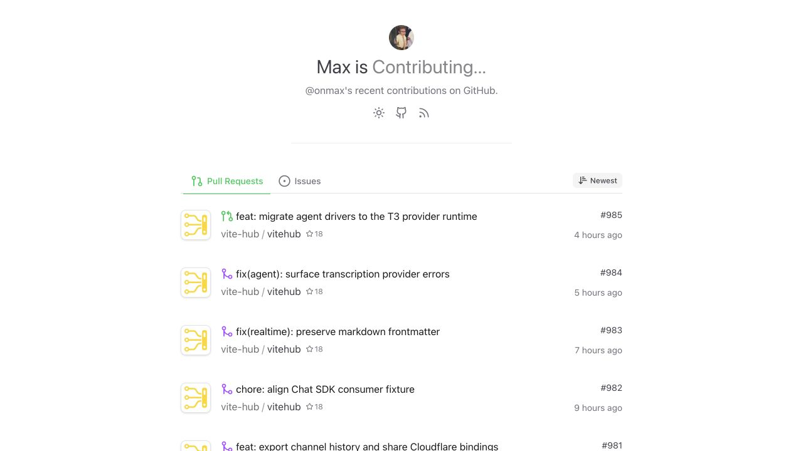
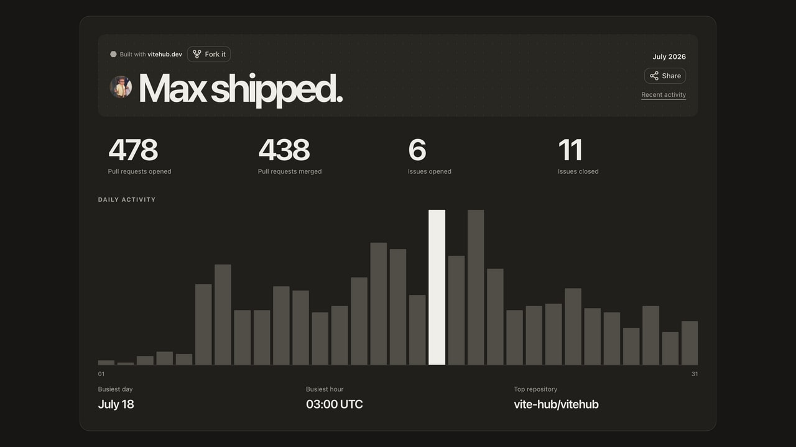

# ViteHub Pull Requests

A public dashboard for recent open source contributions on GitHub, GitLab, Codeberg or another Forgejo, or Gitea, plus a shareable recap generated every month.

[View it live →](https://prs.onmax.me)

## Recent contributions

See my latest pull requests and issues at [prs.onmax.me](https://prs.onmax.me).

[](https://prs.onmax.me)

## Monthly recap

Every month, get an email with a summary of what you shipped. See my [July 2026 recap](https://prs.onmax.me/recap/2026-07).

[](https://prs.onmax.me/recap/2026-07)

## Features

- 🔎 **Browse, filter, and sort contributions** across public GitHub repositories with [Sources](./server/sources). Filter by title words, `is:`, `org:`, `repo:`, and `created:`, then share the URL, for example [`?q=perf org:nuxt is:merged`](https://prs.onmax.me/?q=perf+org:nuxt+is:merged)
- 📰 **Follow new activity** through an RSS feed
- 📅 **Generate monthly recaps** with totals, trends, and a top repository using [Schedule](./server/schedules) and [Workflow](./server/workflows)
- 🖼️ **Share each recap** as a page or image, or send it with [Email](./server/emails)
- 💾 **Store generated recaps** with [KV](./server/workflows/monthly-recap/02-store.ts)
- 🔐 **Load GitHub and email configuration** with [Env](./nuxt.config.ts)

## Start

Requires Node.js 24.15+ and pnpm 11.

```sh
git clone https://github.com/vite-hub/my-pull-requests.git
cd my-pull-requests
pnpm install
cp .env.example .env
```

Choose a forge and add a token for your account to `.env`. GitHub is the default:

```dotenv
FORGE=github
FORGE_TOKEN=your-token
```

| Forge | `FORGE` | `FORGE_BASE_URL` | Token |
| --- | --- | --- | --- |
| GitHub | `github` (default) | Only for GitHub Enterprise Server | A [fine-grained token](https://github.com/settings/personal-access-tokens/new) with no special scopes |
| GitLab | `gitlab` | Only outside gitlab.com | A personal access token with `read_api` |
| Codeberg, Forgejo | `forgejo` | Only outside codeberg.org | An access token with read access to issues, repositories and users |
| Gitea | `gitea` | Only outside gitea.com | An access token with read access to issues, repositories and users |

The dashboard reads the forge through [forges](https://forges.link). Only public repositories are listed, but a token that can read private repositories still counts them in totals on GitLab, Forgejo and Gitea, so give it public access only where the forge allows. `GITHUB_TOKEN` and `NUXT_GITHUB_TOKEN` still work for GitHub.

The filter supports everything on GitHub. GitLab, Forgejo and Gitea use their own text search, search one owner or repository at a time and have no `created:`, merged or draft filter. Forgejo and Gitea list newest first only. When a forge does not report a total, the dashboard shows the loaded count with `+` while more pages remain.

```sh
pnpm dev
```

Monthly email also needs `RECAP_FROM`, `RECAP_TO`, and `RECAP_SITE_URL`. Recap images need `NUXT_APP_SECRET`, at least 32 characters, to sign their URLs. Generate one with `npx nuxt-og-image generate-secret`.

## Deploy

Choose a ViteHub preset in `nuxt.config.ts`, configure KV and email for that host, then run `pnpm build`. See the [host support matrix](https://vitehub.dev/docs/frameworks-hosts/support-matrix).

## Credits

Based on [atinux/my-pull-requests](https://github.com/atinux/my-pull-requests), inspired by [Anthony Fu](https://github.com/antfu)'s [releases.antfu.me](https://github.com/antfu/releases.antfu.me).

## License

[MIT](./LICENSE)
